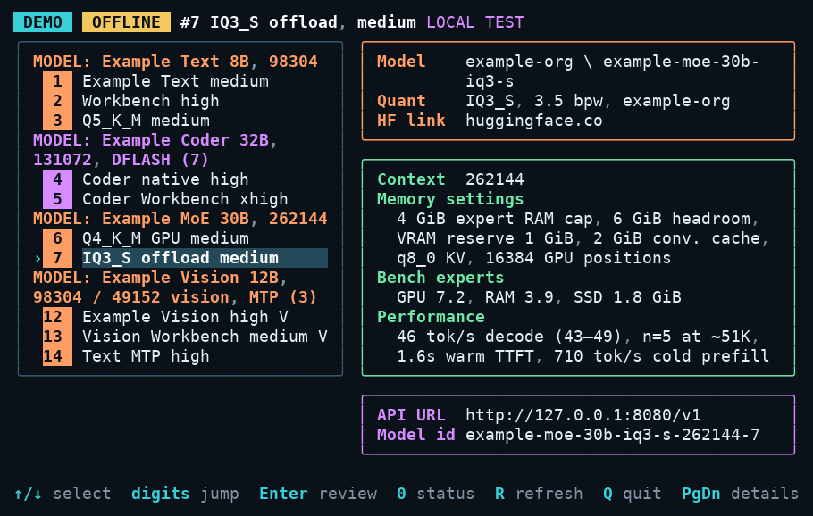

# LLM TUI 1.0.1

This is my reference for how I like my LLM engine start scripts to look and
feel, whether I run `start.sh` on Linux or `start.ps1` on Windows.

Confirm a profile and the launcher starts the LLM in the background, reports
readiness and connection details, then returns you to the shell. This repo
provides the reusable picker and a demo with fictional profiles.

- [Layout and measurement rules](LAYOUT.md): the approved visual contract.
- [Catalog and result protocol](PROTOCOL.md): adapter contract and workflow.
- [Synthetic example](examples/catalog.json): ten profiles covering text,
  vision, drafting, and expert offload. Profile 7 shows the memory settings
  alongside example expert placement and benchmark results.
- [Renderer](main.go): adapted from the approved vLLM Bubble Tea/Lip Gloss UI,
  with the file handoff used by the Windows launcher family. See [go.mod](go.mod)
  and [go.sum](go.sum) for inherited dependency pins. No new license is granted
  here; existing dependency notices and terms still apply.

## Preview

Requires Go 1.25 or newer with the pinned modules already cached and Bash for
the build helper. The screenshot shows the reference layout at 80 columns by
25 rows. Shorter terminals show fewer rows at a time. Narrow terminals give
the picker and profile details the full width in separate views. Use Page Down
to open extra details and Page Up to return to the picker or overview.
Linux/WSL is the intended local build environment. Windows is a cross-build
target (`GOOS=windows GOARCH=amd64 bash build.sh`).

From the Git root, `bash build.sh` builds into the sibling `run/` directory and
seeds its catalog only if absent. In the project workspace, use the
top-level `start.sh`. From a standalone Git checkout on Linux, run
`../run/llm-tui | cat` to open the same picker with its screen on stderr and
the confirmed ID on stdout. On Windows, run `llm-tui.exe`. The ten example
profiles contain fictional model, speed, and status data. Pass `--version` to
print the picker version.

For a new engine, point the adapter at this repository, export its resolved
JSON, then wire the confirmation result into its launcher. The adapter owns
engine flags, endpoint checks, and the process lifecycle. Follow the
[launcher script conventions](PROTOCOL.md#launcher-scripts) for status, logs,
and stopping the engine.
